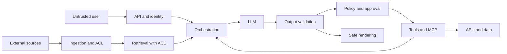

# Merestone 0.3 operational method

## 1. Purpose, limits and principles

Assess, with authorization, confidentiality, integrity, availability, privacy and business-action risks in complete AI systems. This includes commercial/local models, RAG, agents, tools, MCP, APIs, data, pipelines, identities, infrastructure and dependencies. The taxonomy guides coverage; it does not replace hypotheses or evidence. Tests are bounded sampling and do not demonstrate the absence of vulnerabilities.

Treat as untrusted data both external inputs and model outputs, retrieved content, memory, tool results and messages between agents. A model proposes actions; a deterministic component verifies identity, authorization, schema, scope and approval before executing them. Separating instructions from data helps, but it is not an authorization boundary.

The unit of assessment is a complete route: origin → transformation → context → decision → tool → resource → effect. Measure the effect on the final component, in addition to the model's text. Record a textual refusal together with an improper action as a failure, and an odd response without demonstrated impact as an observation.

## 2. Responsibilities

| Role | Responsibility and decision |
|---|---|
| System owner | Authorizes scope, resources and restoration; provides test accounts |
| Security lead | Approves the plan, coordinates stopping, reviews findings and coverage |
| Assessor | Executes within limits, keeps traces and reproduces hypotheses |
| Engineering/MLOps | Instruments, corrects and delivers identifiable versions |
| Data/privacy owner | Classifies corpus, retention and access to evidence |
| Independent reviewer | Verifies reproducibility, impact and closure |
| Business owner | Accepts residual risk with an expiry; does not delegate acceptance to the assessor |

In small teams one person can cover several roles, but closing high/critical findings requires a review by someone other than the implementer.

## 3. Cycle with exit gates

| Phase | Engineer's steps | Deliverable and exit condition |
|---|---|---|
| **0. Prepare** | Agree on objectives, scope, identities, data, limits, contact, stop conditions and restoration | Valid charter; safe preconditions and budget for the chosen activities |
| **1. Understand** | Interview, inventory, trace data/identities, cross-check the deployment and classify capabilities | Diagram and inventory; unknowns identified with an owner |
| **2. Model threats** | Formulate actor → access → input → boundary → effect; review STRIDE and AI threats | Prioritized threats and expected controls; every critical route has a hypothesis |
| **3. Review design and configuration** | Evaluate architecture, permissions, provenance, isolation, configuration and third parties | Verified deficiencies; updated hypotheses and instrumentation requirements |
| **4. Design the plan** | Select cases per obligation; fix fixtures, oracles, examples, repetitions and scenarios | Frozen plan; every obligation has an activity or a justified exception |
| **5. Prepare and test components** | Snapshot; benign baseline and negative controls; direct tests, measurement and cleanup | Results and evidence per boundary; distinguish a control failure from a lab failure |
| **6. Run scenarios** | Chain techniques by objective; verify reachability, identity, decisions and effect; record adaptations | Demonstrated E2E impact or breakpoint; detection result kept separate |
| **7. Validate and consolidate** | Reproduce, rule out false positives, identify causes and scope; evaluate uncertainty | Reviewed findings with sufficient evidence and visible pending coverage |
| **8. Report and remediate** | Explain risk, prioritize corrections, assign owners and temporary acceptance where appropriate | Report, treatment plan and decisions on unassessed risks |
| **9. Retest and maintain** | Repeat original, neighbors and benign; review full routes and detection; add regression | Justified closure or residual risk; suite linked to change triggers |

The phases allow going back: a reconnaissance finding can change the architecture, and a test can uncover another boundary. The plan keeps the history of those changes. Design or configuration deficiencies can be reported before demonstrating exploitation, making the scope of the evidence clear.

## 4. Rules for authorized execution

Sign off on environment, dates, time zone, allowed addresses/resources, identities, tenants, techniques, data and excluded actions. Include provider authorizations where applicable. Separate permission to read, write, upload documents, tune models and test consumption limits. Start in staging with synthetic data and simulated tools.

Before running, define maximums for requests, tokens, cost, concurrency, duration and payload size; the absence of a limit blocks that campaign. For availability tests, increase in steps up to the approved threshold, without trying to bring the service down. Stop on unexpected real data, tenant crossing, unauthorized effects, service degradation or loss of observability. Keep the minimum evidence, notify the incident contact and restore through the agreed procedure. Only the owner can authorize a later expansion.

## 5. Architecture and reconnaissance

Inventory: provider/model/version and parameters; prompts and guardrails; UI and APIs; router/orchestrator; conversation and memory storage; ingestion, chunking, embeddings, indexes, reranking and ACLs; agents and delegation relationships; tools, descriptions, schemas, MCP transports and permissions; IAM, secrets, egress, containers, administration endpoints; training/fine-tuning, model registry, CI/CD and dependencies.

For each flow, record origin/destination, classification, owner, effective identity, authorization, transformations, persistence, logs and network egress. Include streaming, queues, caches, retries and batch processes. Mark boundaries: user/service, tenants, documents/instructions, model/executor, agent/agent, MCP server/API and build/production.

Reconnaissance: compare documentation with read-only configuration, API routes and effective permissions; interview owners; review SBOM/AIBOM, registries and manifests. Do not scan the provider's domains or extract proprietary weights without a specific scope.

## 6. Threat modeling

For each boundary, use STRIDE as questions: who can spoof, tamper with data, repudiate an action, obtain data, exhaust resources or elevate privileges. Add AI-specific objectives: changing behavior through content, poisoning memory/knowledge, inducing valid but out-of-purpose calls and tampering with model artifacts.

Documented hypothesis: "A low-privilege document editor can insert instructions into a retrieved fragment and trigger a read with the agent's identity on another tenant's documents". Assets: corpus and search tool. Precondition: indexing without provenance and broad permissions. Route: document → retriever → LLM → call → API. Controls: ACL on the query and the tool, delegated identity, approval of effects. Cases: AI-002, AI-006, AI-014 and AI-029. Decisive evidence: another tenant's document in the context or the tool's effect, not a claim by the assistant.

Prioritize routes by exposure, privileges, asset value and magnitude of the effect. Record black-box/gray-box/white-box access: missing traces limit the conclusion. Test isolated components and end-to-end chains; deduplicate the same root cause while keeping each route and impact.

## 7. Reproducible execution

1. Freeze the case revision and snapshot: commit, model, prompt hash, corpus/index hash, permissions, tools, defense configuration and parameters. Record an unknown version as such; do not invent it.
2. Prepare unique canaries per trial, A/B accounts, fixtures and the initial state. Verify clock and trace correlation.
3. Run a benign positive control: the system does what is allowed. A service that rejects everything does not prove useful security.
4. Run the adversarial variant and observe context, decisions, calls and final effect. Isolate one change per variant; record the order and reset the state.
5. For stochastic behavior, justify the sample size and threshold before testing; 20 trials may serve for initial exploration, but they are not a universal minimum or sufficient evidence for any conclusion. Record every success and failure, seeds where they exist, temperature and version. A seed does not guarantee reproduction with external providers. A single verifiable improper effect can validate the finding.
6. Repeat from a clean state, preserve evidence, clean up fixtures and confirm restoration. If permissions or observability are missing, mark BLOCKED or INCONCLUSIVE.

Separate three axes: applicability APPLICABLE/NOT_APPLICABLE/UNKNOWN; execution NOT_RUN/BLOCKED/ERROR/COMPLETED; result empty/PASS/FAIL/INCONCLUSIVE. Only COMPLETED admits a result. No state other than PASS counts as demonstrated protection. Scope and access are recorded separately. An accepted exclusion keeps its risk and does not increase decided coverage.

Attack success rate = trials with a violation / valid trials of the same variant. Publish the numerator, denominator and configuration; do not mix ERROR/INCONCLUSIVE or versions. For n=20 and zero failures, the approximate one-sided 95% upper bound is 3/n=15%; zero failures does not prove zero risk. For formal comparison use exact/Wilson binomial intervals and justified samples; the MVP does not perform statistical inference.

## 8. Evidence and traceability

Minimum chain: threat → case/review → asset → expected control → run/trial → evidence → finding → correction → retest → regression. Keep the request/response, retrieved documents with IDs/ACLs, tool name/args/result, authorization decision, effective identity and final effect. Do not store the model's internal reasoning as a requirement; use observable events.

Each evidence item carries an ID, run ID, UTC timestamp, collector, origin, classification, size, SHA-256 hash, private location and applied redactions. SHA-256 detects changes if a reliable reference is kept; it does not prove authorship or authenticity. Encrypted original in a restricted store and a sanitized copy for review. Record access, the retention policy and agreed deletion; do not set universal retention. The runner only computes fingerprints of the files it evaluates; it does not implement enterprise custody.

## 9. Findings, severity and confidence

Separate technical vulnerability, out-of-policy behavior and governance deficiency. Do not automatically classify the disclosure of a prompt without secrets as a leak; demonstrate which protected information or control was exposed. A false positive is closed with an explanation and evidence, keeping the history.

Local prioritization method, not CVSS: Impact I and Feasibility F from 1 to 5; score I×F. I: 1 cosmetic effect, 2 limited reversible effect, 3 internal information or affected process, 4 sensitive data/important privileged action, 5 systemic or irreversible impact. F: 1 exceptional access, 2 high privilege and complex chain, 3 normal access with conditions, 4 low privilege and frequent reproduction, 5 broad exposure and simple reproduction. Severity: 1–4 low, 5–9 medium, 10–16 high, 17–25 critical. Systemic impact I=5 requires priority review even if F is low. Justify each axis and exceptions; LLM frequency does not replace exposure.

Separate confidence: high with effect and independent reproduction; medium with a single effect/partial trace; low with an unvalidated indication. Record CVSS only when a formal methodology applies and the version/vector are documented; do not convert this matrix to CVSS.

Proposed SLA for adoption: critical containment in 24 h and plan in 72 h; high plan in 7 days/correction in 30; medium 60; low 90. These are suggested internal objectives, subject to owner and risk, not regulatory obligations. Each exception requires compensation, an approver, an expiry and a next review.

## 10. Remediation and closure

Contain permissions and egress; correct the control at the boundary that caused the problem; use prompts/guardrails as an additional defense. Test allowed utility and new routes. Flow: new → triage → confirmed → assigned → in remediation → ready for retest → closed. Alternatives: false positive, duplicate, accepted risk with expiry. If it reappears, reopen it and link the run. Accepted is not the same as corrected.

Closure requires a corrected version, the original no longer violating the policy, nearby variants, a passing benign test, traces of the effective control and independent review. Keep the finding ID and add new runs without overwriting the originals. For critical effects, repeat on the full route; an isolated unit test is not enough.

## 11. Regression, coverage and adoption

Changes to model/prompts: injection, leakage, behavior and output. Corpus/embeddings/chunking: RAG, ACL, provenance and poisoning. Tools/permissions: authorization, approval, abuse and MCP. Infra/deployment/dependencies: identity, supply chain, isolation and rollback. Every significant change also runs the minimum set of critical routes.

Suggested gates: do not release with a confirmed critical/high violation without a current acceptance; do not approve a mandatory suite with ERROR, INCONCLUSIVE or NOT_RUN; every exclusion requires a reason. The CLI conservatively blocks on any FAIL and incomplete evidence; exception/SLA management stays in the manual process and is not implemented as a policy engine.

Metrics: coverage of applicable cases (run/applicable), boundaries with evidence, new failures, time to containment/correction, recurrence, percentage of retested closures, attack success and benign false refusal. Do not use the raw number of prompts as coverage.

Adoption by milestones: (1) one manual assessment with an owner and traces; (2) adapt the observation exporter to an application and repeat results; (3) integrate the CLI into private CI with retention and access; (4) add isolated connectors, suite scheduling and finding management. Success criterion for the first pilot: all boundaries inventoried, applicable cases justified, reproducible findings and at least one retested correction, if there were findings. The catalog is an extensible base, not exhaustive coverage of all AI risks.

## 12. Operational contract of version 0.3

The canonical work phases are: prepare; understand the architecture; model threats; review design/configuration; plan; test components; run scenarios; validate/consolidate; report/remediate; retest/maintain. The preceding steps of this manual detail their practices; the operational entry order is in [start](../start.md), whose section 0 contains the mapping table between its sections and these phases. The common-core reviews (CORE-001…008) require at least one route to declare DESIGN; `check-plan` treats it as a readiness gap (`core_design_missing`). Terms are defined in the [glossary](glossary.md).

Plan 3.0 separates applicability (APPLICABLE/NOT_APPLICABLE/UNKNOWN), execution (NOT_RUN/BLOCKED/ERROR/COMPLETED) and result (PASS/FAIL/INCONCLUSIVE). Scope and access are separate dimensions. An accepted exception remains visible as an exclusion and does not increase decided coverage.

A DESIGN/CONFIG review uses documentary evidence. A TEST/REDTEAM test records baseline, input, response, effect, identity and reachability. The oracle belongs to the case's control, not to the detector or the model's response. If the payload was blocked by an earlier control, demonstrate that control without claiming resistance of the component that was not reached.

The approved external manifest and evidence with hashes/sizes allow verifying the record's consistency; they do not authenticate the collector or replace human review. Never put real credentials, keys or datasets in the public catalog.

For closure, risk and regression see [findings](findings-and-regression.md). For architecture/catalog changes, keep previous plans and generate a new one with history, according to [maintenance](maintenance.md).

## 13. Frozen depth and variations

Before generating the plan, add `test_protocols` to each route for the tests that will be run: case_id, required_variants, min_trials_per_variant, design, decision_rule and justification. [Protocol template](../../templates/test-protocol-v3.json). The case must be decided according to its oracle; the protocol rule specifies metrics and thresholds and cannot turn a violation into a PASS. A technical activity without a protocol cannot be closed with PASS/FAIL. An observed failure is kept even if variants are missing, and the plan remains incomplete.

In fixed experiments, separate calibration/holdout and fix the rule before measuring. In adaptive exploration, keep the order, attempts, adjustments and budget; do not interpret its success proportion as an unbiased estimate of a population. Repetitions belong to the same variant and snapshot. For ML perturbations, describe constraints and label validation; for privacy, fix the auxiliary-knowledge baseline, prevalence and FPR; for retrieval, measure reachability and authorized chunks before generation.

Report counts are grouped by task and variant. Distinguish benign from adversarial trials when calculating ASR: do not add both denominators. Also report benign false refusals, reachability rate, violation conditional on reachability when measurable, unreached attempts and the reason for exclusion. For detection, record the alert, timestamp, correlation, triage, containment and time to recovery separately from the prevention result.
